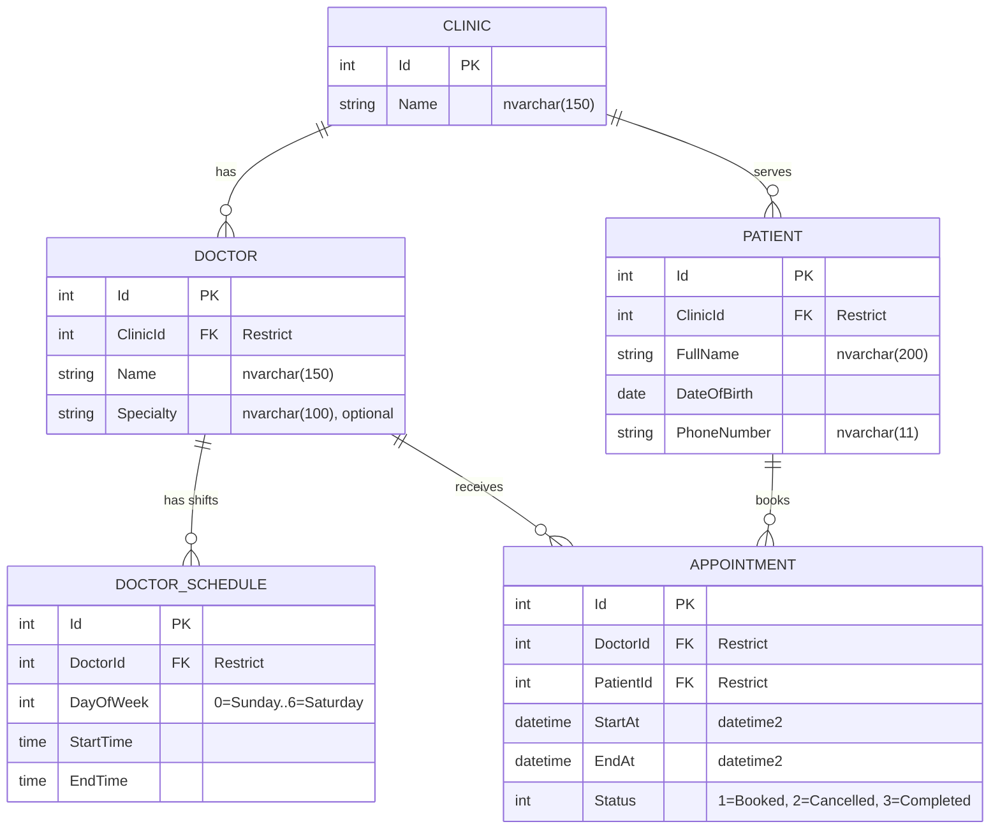

# Clinic Appointment System

Appointment booking for a clinic secretary: doctors with weekly schedules, free 30-minute slots, patient records, and an appointments grid. Built with **ASP.NET Core MVC (.NET 9)**, **Entity Framework Core**, and **SQL Server**.

---

## 1. Features

- **Booking page (secretary)**: enter a new patient's bio data or search an existing patient, choose a doctor and a date, pick a time from the free slots (default visit length is 30 minutes), save, and see the result in the appointments grid.
- **Appointments grid**: filter by date and doctor, view details, cancel or complete an appointment.
- **Patients**: create, edit, search (by name or phone), view history, delete (when allowed).
- **Doctors and schedules**: create, edit, delete (when allowed), and manage each doctor's weekly working shifts from the doctor's details page.
- **Validation** on the client, server, and database, including Egyptian mobile numbers.

### Seed data

| Doctor | Working days | Hours |
|---|---|---|
| Dr. Ahmed (General) | Saturday to Thursday (no Friday) | 16:00 to 20:00 |
| Dr. Sara (Pediatrics) | Sunday, Tuesday, Thursday | 10:00 to 14:00 |

One clinic ("My Clinic") is seeded and used for all patients and doctors.

---

## 2. Architecture

The solution uses a 3-layer architecture:
`Clinic.PL -> Clinic.BLL -> Clinic.DAL` (the presentation layer never references the DAL directly).

```
ClinicSystem/
├── ClinicSystem.sln
├── Clinic.DAL/           # Data Access Layer
│   ├── Entities/         # Clinic, Doctor, DoctorSchedule, Patient, Appointment
│   ├── Enums/            # AppointmentStatus: Booked=1, Cancelled=2, Completed=3
│   ├── Data/             # ClinicDbContext (check constraints, filtered unique index, seed)
│   └── Migrations/       # InitialCreate, HardenValidation
├── Clinic.BLL/           # Business Logic Layer
│   ├── Common/           # OperationResult and OperationResult<T>
│   ├── Helpers/          # PhoneNumberNormalizer
│   ├── Interfaces/       # IAppointmentService, IPatientService, IDoctorService
│   ├── Models/           # DTOs and request records
│   ├── Services/         # AppointmentService, PatientService, DoctorService
│   └── DependencyInjection.cs
├── Clinic.PL/            # Presentation Layer (ASP.NET Core MVC)
│   ├── Controllers/      # Appointments, Patients, Doctors, Home
│   ├── Validation/       # EgyptianPhoneAttribute (server and client validation)
│   ├── ViewModels/
│   ├── Views/
│   └── wwwroot/          # site.css, validation adapters, site.js
└── Docs/
    ├── Database.sql      # Full SQL script generated from the migrations
    ├── ERD.png           # Entity-relationship diagram
    └── TestPlan.md       # Test plan and test cases
```

---

## 3. Key Design Decisions

1. **Slots are generated, never stored.**
   Slots are computed from `DoctorSchedules` in fixed 30-minute steps (`SlotMinutes = 30`). A slot is generated only if it fits entirely inside the shift (`t + step <= end`). Slots on days without a schedule, slots that already started today, and slots overlapping active appointments are excluded. A day may have more than one shift.

2. **A filtered unique index prevents double booking.**
   `Appointments (DoctorId, StartAt) WHERE [Status] <> 2` guarantees at the database level that two active appointments cannot share a doctor and start time. A cancelled appointment is excluded by the filter, so its slot becomes available immediately. Availability is also rechecked at save time, and a unique-index violation is turned into a friendly message.

3. **Friday is a day off by the absence of a row.**
   There is no flag for days off: a day without a `DoctorSchedules` row is a day off. The doctor details page shows these days as "Day off".

4. **Egyptian mobile numbers are validated in three places.**
   - **Client**: a jQuery unobtrusive adapter validates the number while typing.
   - **Server and BLL**: `PhoneNumberNormalizer.TryNormalize` removes spaces, dashes, dots and parentheses, converts the `+20`, `0020` and `20` prefixes to a leading `0`, and enforces `^01[0125][0-9]{8}$`. The number is stored as `01XXXXXXXXX`.
   - **Database**: the column is `nvarchar(11)` and required.

5. **No repository layer.**
   Services use `ClinicDbContext` directly, because EF Core already provides the repository and unit-of-work behavior.

6. **Implicit clinic scope.**
   The clinic is seed data. New patients and doctors are assigned to the first clinic inside the BLL, and no clinic pages exist.

---

## 4. Business Rules

- **Appointments are never deleted.** A `Booked` appointment can be **cancelled** (the slot is freed) or **completed** (only after its start time has passed).
- **Past bookings are rejected.** Past dates cannot be booked, and neither can slots that already started today.
- **Patients and doctors cannot be deleted if they have any appointment**, including cancelled ones, so visit history is preserved. Deleting a doctor with no appointments also removes the doctor's schedule rows.
- **Schedules**: shifts must start and end on 30-minute boundaries, must end after they start, and must not overlap another shift of the same doctor on the same day. A shift cannot be deleted, moved, or shortened if future booked appointments would fall outside it.
- **Patient selection while booking**: the secretary can search for an existing patient (by name or phone) or type a new one, which is created automatically. An existing patient must belong to the same clinic as the doctor.
- **Duplicate patients**: creating or editing a patient with the same name, date of birth and phone number as an existing one is rejected.

---

## 5. Assumptions

- **Single clinic**: one clinic is seeded, and no clinic management is exposed.
- **Local time**: dates and times use the server's local time zone, which is assumed to be Cairo time. Times are not converted to UTC.
- **Egyptian mobile numbers only**: landlines and non-Egyptian numbers are rejected. Supported prefixes: Vodafone (`010`), Etisalat (`011`), Orange (`012`), WE (`015`).
- **Fixed visit length**: every appointment lasts 30 minutes.
- **No rescheduling action**: to reschedule, cancel the booking and create a new one.
- **No authentication**: the system is designed for a single receptionist/secretary workstation and has no user accounts or roles.

### Known limitation

If two secretaries simultaneously book the same brand-new patient, duplicate patient rows may be created, because `Patients` has no unique constraint (patients may legitimately share a name or a family phone number). Double booking of a slot is not affected: it is prevented by the filtered unique index.

---

## 6. How to Run

### Prerequisites

- [.NET 9 SDK](https://dotnet.microsoft.com/download)
- SQL Server (LocalDB, Express, or Developer edition)
- The EF Core CLI: `dotnet tool install --global dotnet-ef`

### Configure the connection string

Check `Clinic.PL/appsettings.json`:

```json
"ConnectionStrings": {
  "DefaultConnection": "Server=.;Database=ClinicDb;Trusted_Connection=True;TrustServerCertificate=True"
}
```

### Create the database

From the solution folder:

```bash
dotnet ef database update -p Clinic.DAL -s Clinic.PL
```

Alternatively, run `Docs/Database.sql` in SQL Server.

### Start the application

```bash
dotnet run --project Clinic.PL
```

Open the HTTPS URL printed in the console (ports are configured in `Clinic.PL/Properties/launchSettings.json`). The default route opens the Appointments page.

### Regenerate the SQL script

```bash
dotnet ef migrations script --idempotent -p Clinic.DAL -s Clinic.PL -o Docs/Database.sql
```

---

## 7. Testing

A full manual test plan covering the database, slot generation, booking, validation, concurrency, cancel/complete, patients, doctors, schedules, security, and UI is available in [`Docs/TestPlan.md`](Docs/TestPlan.md).

---

## 8. Entity-Relationship Diagram



---

## 9. Future Improvements

1. **Authentication and roles** (secretary, doctor, administrator) with ASP.NET Core Identity, and recording who created each booking.
2. **Multi-tenancy (multiple clinics)**: each clinic becomes a tenant with isolated data.
   - Keep a single database and use `ClinicId` as the tenant key (already present on `Doctor` and `Patient`; `DoctorSchedule` and `Appointment` are scoped through their doctor).
   - Resolve the current clinic per request (for example from a `/{clinic-slug}/...` URL, later from the signed-in user) through an `ITenantProvider`.
   - Apply EF Core global query filters so every query is limited to the current clinic and returns nothing when no clinic is resolved.
   - Add clinic management pages (create and edit a clinic) and a clinic switcher.
   - Real isolation requires authentication (users bound to a clinic), otherwise tenant separation is only a data filter and not a security boundary.
3. **Doctor leave and public holidays** as schedule overrides.
4. **One-step rescheduling** that moves a booking to another slot atomically.
5. **Soft delete** for doctors and patients (an `IsActive` flag) instead of blocking deletion.
6. **SMS or WhatsApp reminders** for booked appointments.
7. **Clinic contact details** (address, phone, working hours).
